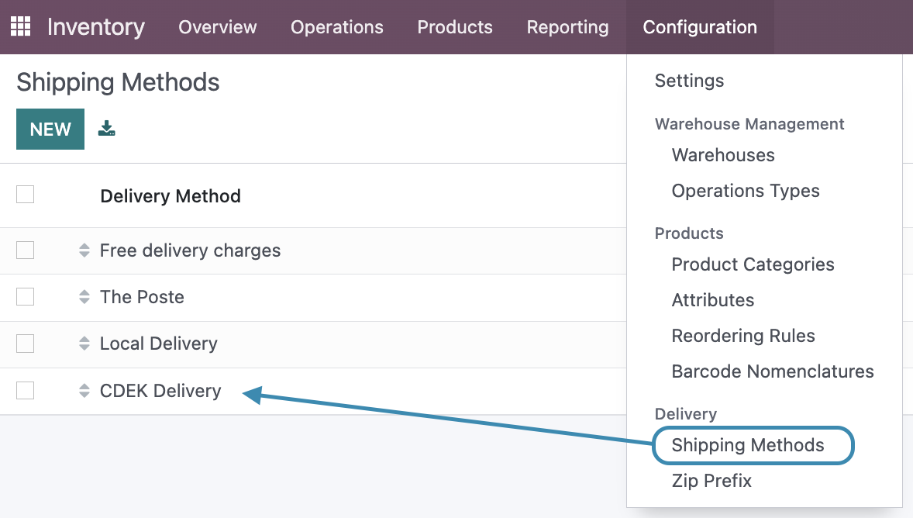
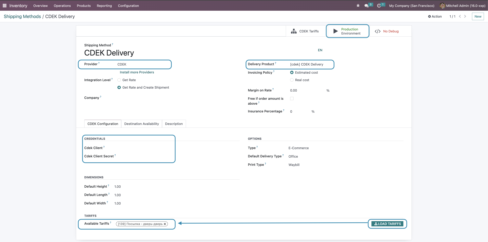
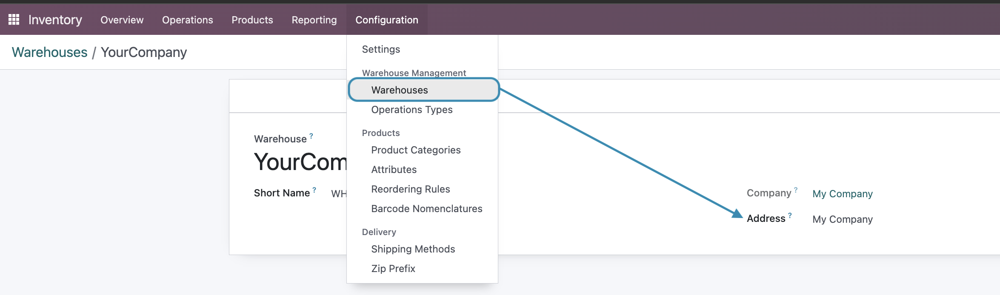
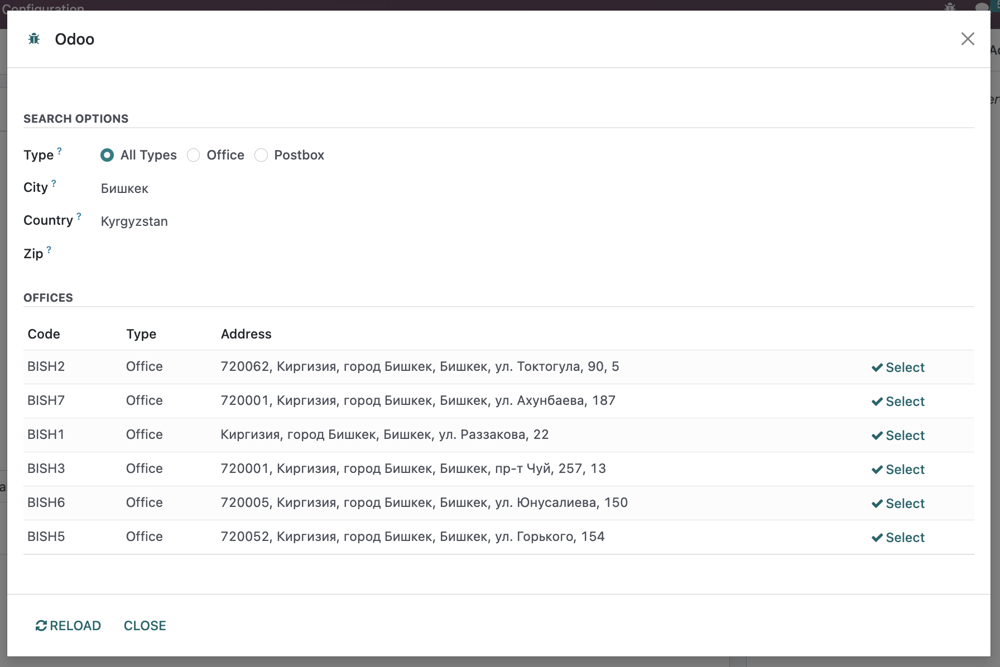
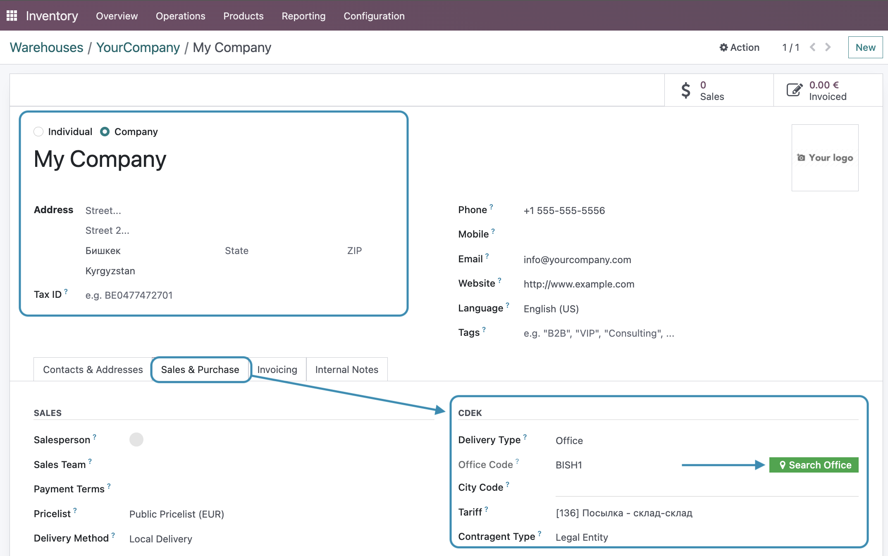
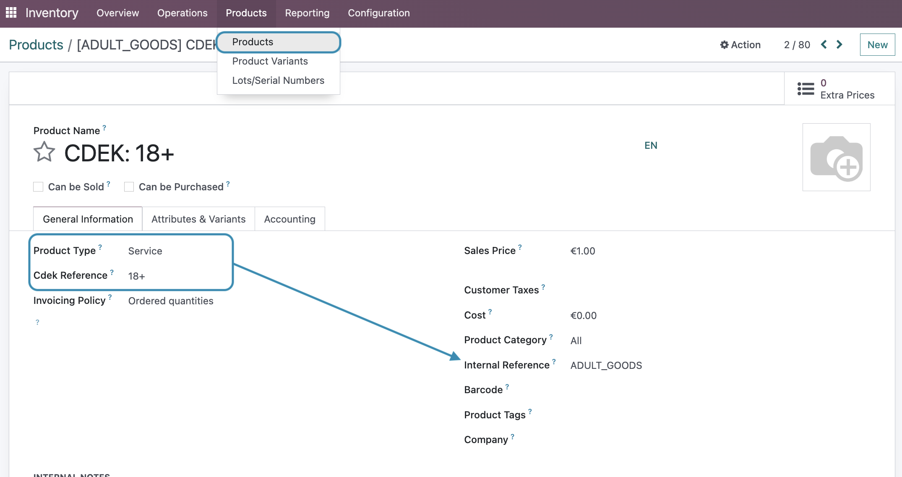
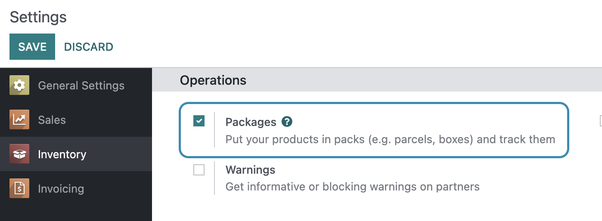
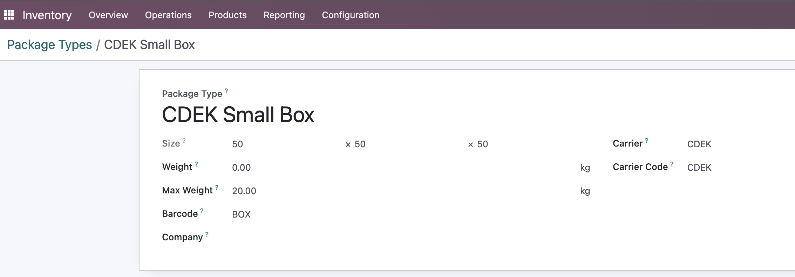

## Obtain CDEK API Credentials

1. Register in the CDEK personal account: https://www.cdek.ru/
2. Obtain API credentials (Client ID and Client Secret)
3. Save these credentials for later configuration

## Configure CDEK Carrier

#### Step 1: Accessing Delivery Settings

1. Go to **Inventory > Configuration > Shipping Methods**
2. Find the carrier "CDEK Delivery"

#### Step 2: Basic Configuration

1. Open the CDEK carrier form
2. Make sure the **Provider** field is set to "CDEK"
3. Make sure the **Delivery Product** field is set to "CDEK Delivery"

#### Step 3: CDEK Configuration

Go to the **CDEK Configuration** tab and fill in the following parameters:

**API Credentials (for production environment)**

1. Activate Production Environment mode using the smart button in the upper-right corner of the carrier form
2. Enter **CDEK Client ID** — client identifier from CDEK
3. Enter **CDEK Client Secret** — client secret key from CDEK

> **Important:** If Production Environment mode is not activated, test credentials will be used.

**Loading Tariffs**

1. Click the **Load Tariffs** button next to the **Available Tariffs** field
   - This will load all available tariffs from the CDEK API
2. Select the required tariffs from the **Available Tariffs** dropdown

> **Important:** Please consult your CDEK manager for suitable tariffs.

#### Step 4: Options

Configure additional parameters:

1. **Type**:
   - "E-Commerce" (1) — for online stores
   - "Delivery" (2) — for standard delivery

2. **Print Type**:

   Used for uploading printed documents for order fulfillment.
   > **Important:** This functionality will be available in PRO version*

   - "Waybill" — waybill printing
   - "Barcode" — barcode printing

3. **Default Delivery Type**:
   - "Door" — shipment from warehouse/office
   - "Office" — shipment from CDEK pickup point
   - "Terminal" — shipment from CDEK terminal

#### Step 5: Configure Warehouse or Recipient Address for CDEK Delivery

1. Go to **Inventory > Configuration > Warehouses**
2. Select a warehouse record and open the address partner record

## Configure Partner record for CDEK

1. Go to the partner record
2. Open the **Sales & Purchases** tab > **CDEK** section
3. Specify **Delivery Type**
4. If **Delivery Type** is "Door", fill in the required contact information:
   - **City** — city
   - **Street** — street and address
   - **Country** — country
   - **Zip** (optional) — postal code
   - **Phone** — phone number
5. If **Delivery Type** is "Office/Postbox":
   - Click the **Search Office** button

   In the wizard:
   - Fill in the required fields
   - Click the **Load**/**Reload** button
   - Click the **Select** button for the selected record

6. Select the delivery tariff from **Tariff**
7. **Contragent Type** is automatically determined based on partner type (company/individual):
   - "Legal Entity" — legal entity
   - "Individual" — individual

## Manage CDEK Services

> **Note:** Most services are already pre-configured, so you generally don't need to configure them unless CDEK has updated the list.

1. Go to **Products > Products** (remember to clear any preset filters)
2. Create a new product or open an existing one
3. Set product type as **Service**
4. Select **CDEK Reference** from [available services](https://apidoc.cdek.ru/#tag/common/Prilozheniya/Prilozhenie-6.-Dopolnitelnye-uslugi)
5. When selecting a CDEK service reference:
   - The product is automatically configured as a service (not for sale/purchase)
   - The CDEK service code is copied to the Internal Reference field

## Configure Packages

> **Note:** Enable **Packages** in **Settings > Inventory > Operations**.

1. Go to **Inventory > Configuration > Package Types**
2. Select a record or create a new one
3. Configure the box dimensions, and min/max weight
4. Specify the carrier (optional)

