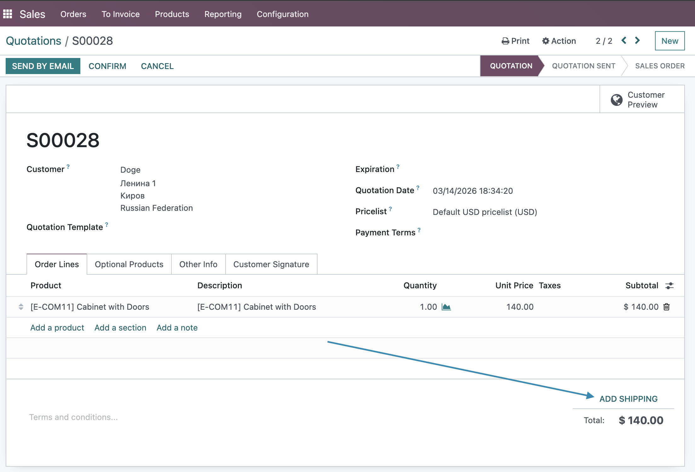
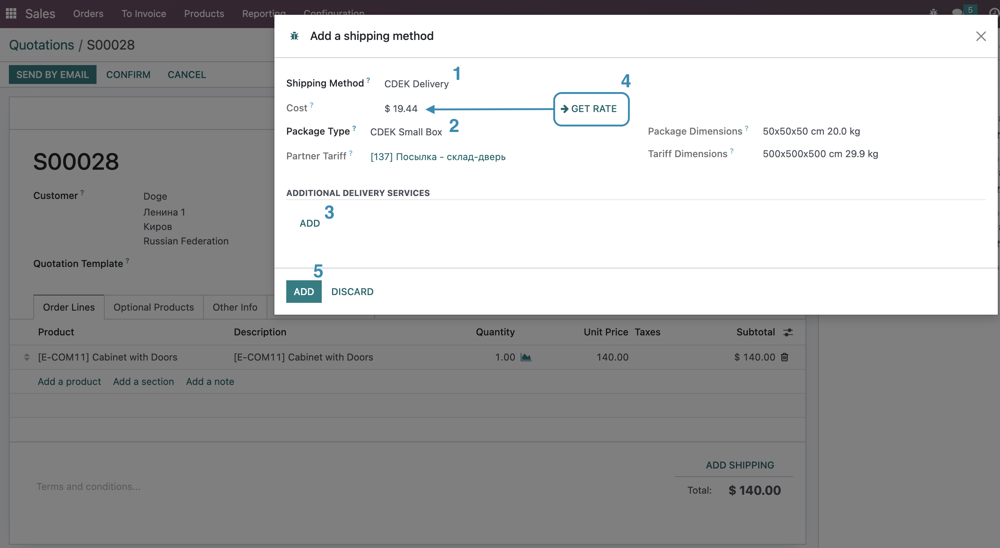
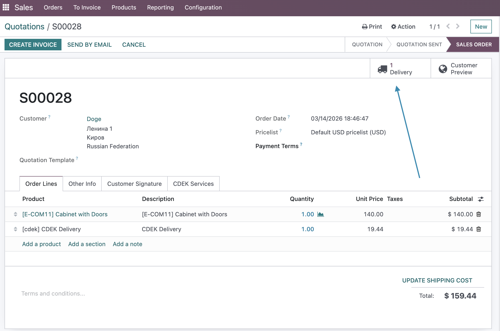
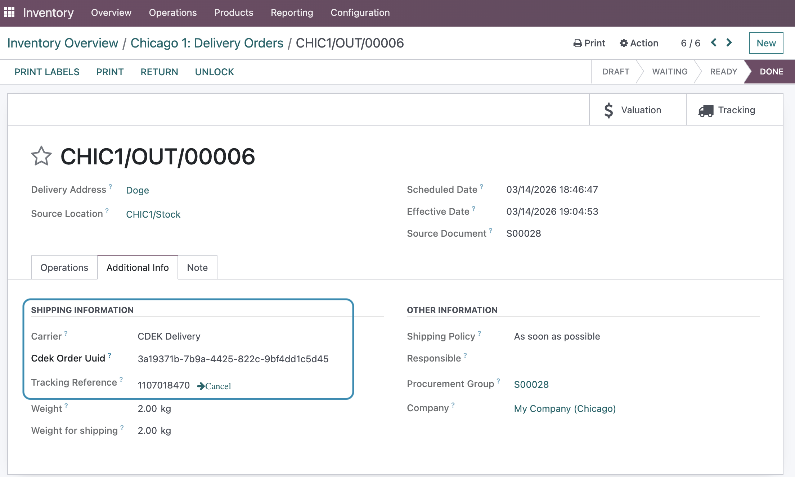

## Sale Flow with CDEK delivery

> **Important:** Make sure you have configured the partner for CDEK delivery.

### Create Sale Order

* Go to the Sales app
* Click the "+New" button to create a quotation
* Select a partner in the "Customer" field
* Add a product to sell
* Click the "Add Shipping" button

### Get Shipping Rate

* On the Add a shipping method wizard:
   * Select CDEK Delivery in the "Shipping method" field
   * Select a package type
   * Add a CDEK Additional Delivery service and the required service value
      - For packages — quantity (integer > 0)
      - For insurance — insurance value (positive number)
      - For SMS — phone number in format +7XXXXXXXXXX
      - For packaging materials — length in meters
* Click the "Get Rate" button
* The service cost will be set automatically
* Press the "Add" button to add the CDEK Delivery product to the sale order

**Delivery Cost Calculation**

When calculating delivery cost, the following are taken into account:
- Selected CDEK tariff
- Package dimensions and weight
- Selected additional CDEK services
- Delivery type (door/office/terminal/postbox)

* Once the sale order is confirmed, Odoo will create a delivery operation

### Register the package

* Go to the created picking operation
* Validate the picking
* Odoo will register the package with the CDEK carrier
* Go to the "Additional Info" tab
* Check the CDEK Order UUID and tracking reference

### To Cancel the Order

* Go to **Inventory > Your Delivery Operations**
* Open a picking to cancel the CDEK Delivery
* Go to the "Additional Info" tab
* Press the "Cancel" button
